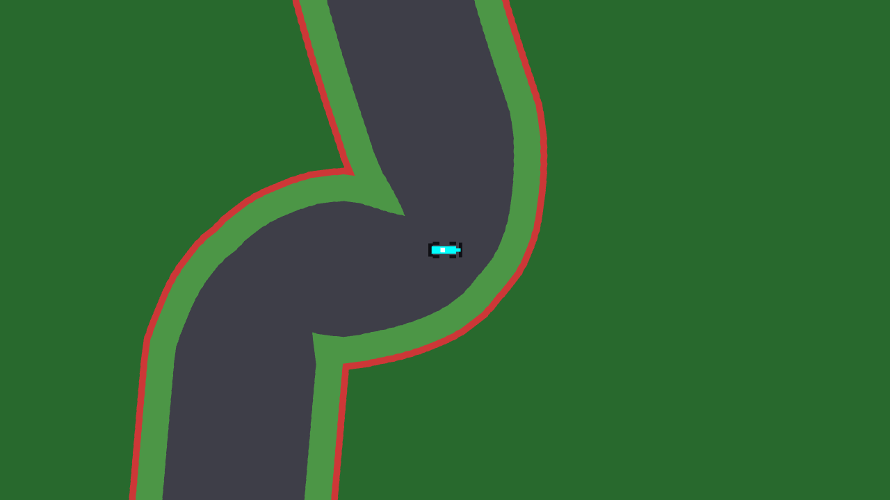
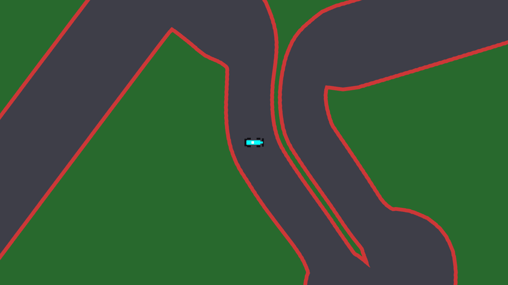
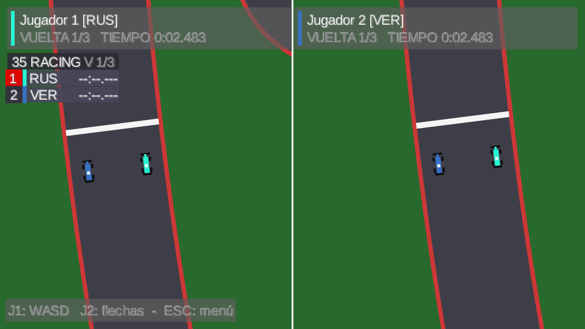
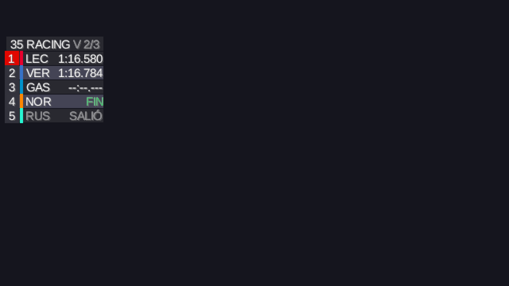

# Etapa 10: Circuitos vectoriales y HUD estilo Fórmula 1

## Objetivo

Cambiar por completo la estética de los circuitos: que ya no se construyan con cuadrados de pixel art (tiles) sino con líneas, de modo que las diagonales sean diagonales y los bordes no se vean escalonados. En el mismo trabajo se ajustó la física del auto, se hizo que la prueba local permita elegir el circuito y se reemplazó el HUD por una torre de tiempos como la de las transmisiones de Fórmula 1.

Esta etapa contradice una decisión del `CLAUDE.md` (los circuitos eran mapas de Tiled), por eso se avisó al grupo antes de empezar y el archivo se actualizó al cerrar.

## Cómo se decidió

Se presentaron tres caminos antes de escribir código:

| Opción | Qué es | Por qué sí o no |
|---|---|---|
| A. Solo cambiar el dibujo | Dibujar con líneas pero dejar la colisión en cuadrados de 16 px | Descartada: el auto chocaría contra escalones que no se ven |
| B. Todo vectorial | Colisión por geometría y reescribir `Carrera`, servidor y formato | Descartada: toca el servidor y el cruce de checkpoints, demasiado riesgo |
| **C. Híbrido** | El circuito se guarda como geometría, se dibuja con líneas y al cargarlo se rasteriza una grilla fina (4 px) solo para la colisión | **Elegida:** `Circuito` conserva su API, así que `Auto`, `Carrera` y el servidor no cambian |

## Qué se hizo

| Pieza | Qué hace |
|---|---|
| `docs/FORMATO_CIRCUITO.md` | Especifica el formato JSON: línea central cerrada con un punto cada 8 px, ancho de asfalto y de pasto en cada punto, checkpoints, largada y cruces |
| `tools/circuitos/generar_circuitos.py` | Genera los 24 circuitos desde los trazados SVG de f1-circuits-svg (Jules Roy, CC BY 4.0); decide los anchos, separa los tramos pegados y arma checkpoints y largada |
| `CargadorCircuito` y `Circuito` | Leen el JSON, validan los campos y rasterizan la grilla de colisión (`Config.CELDA_COLISION`, 4 px); la API pública no cambió |
| `VistaCircuito` | Arma una sola vez círculos apilados sobre cada punto de la línea central, en tres capas (muro, pasto y asfalto), con la misma forma que usa la colisión, y dibuja solo los bloques que entran en la cámara |
| Lanzador | Antialiasing de 4 muestras (`Config.MUESTRAS_ANTIALIASING`) para que los bordes diagonales salgan lisos |
| `Auto` y `ParametrosAuto` | Física más exigente (ver abajo) |
| `PruebaLocal` | Pantalla para elegir el circuito entre los 24 antes de correr; ESC en la carrera vuelve ahí con el mismo circuito |
| `TorreHud` | Torre de tiempos: una fila por auto con la posición (el puntero en rojo), la franja de su escudería, las tres letras del piloto y su mejor vuelta, más "35 RACING" y la vuelta del puntero |
| `tools/circuitos/verificacion` y la skill `circuitos` | Programas para comprobar los circuitos y las instrucciones para volver a generarlos |

## Decisiones

- **El asfalto manda.** En cada punto de la pista el asfalto mide lo más ancho que permita el circuito (128 px como máximo; un 20 % menos en los de 3,4 km o menos, un poco menos en los intermedios) y solo se achica si otro tramo pasa tan cerca que no entra ni el muro, pero nunca baja de 72 px. El pasto es lo que sobra entre el asfalto y el muro, hasta 24 px de cada lado; donde no sobra nada el muro queda pegado al asfalto, como en Mónaco.
- **Callejeros sin pasto.** Los 9 circuitos callejeros (Albert Park, Jeddah, Miami, Gilles-Villeneuve, Mónaco, Madring, Bakú, Marina Bay y Las Vegas) son asfalto y muro; donde estaría el pasto hay asfalto, y se achicaron al 85 %. Los otros 15 conservan el pasto.
- **El muro es sólido hacia afuera.** El muro se dibuja como una línea de 6 px, pero para la colisión todo lo que está más allá del pasto es sólido: a la velocidad máxima el auto avanza unos 7,5 px por cuadro y atravesaría una línea tan fina.
- **Largo de vuelta calibrado con un bot.** El largo de cada circuito sale de una duración por una velocidad media. Para fijarla se escribió un bot que sigue la línea central con la física real; con `SEGUNDOS_VUELTA = 64` da 60,9 s de promedio en los 24.
- **Física.** Velocidad máxima de 450 px/s (antes 360), con la aceleración y los rozamientos escalados. La aceleración arranca en 300 px/s² y pierde el 70 % al llegar a la velocidad máxima, así que los últimos px/s cuestan. El radio mínimo de giro crece con el cuadrado de la velocidad (radio = velocidad² / 520), de modo que la línea de carrera importa más que acelerar a fondo, y girar cuesta un poco de velocidad. El zoom de la cámara pasa de 2 a 1,25. Estos valores se ajustaron en varias rondas según lo que se veía al jugar la prueba local.
- **Cargar el circuito sigue en el hilo de render.** Ya no se crean texturas, pero el archivo se lee con `Gdx.files` y la regla del proyecto es no tocar LibGDX desde los hilos de red. Se agregó una nota en `docs/PROTOCOLO.md`.
- **HUD sin diferencia con el líder ni neumáticos.** Para mostrarlos haría falta medir tiempos por checkpoint y mandarlos por red, o sea tocar el protocolo. La torre muestra la mejor vuelta. Tampoco se usó el logo de Fórmula 1, que es una marca registrada.

## Problemas encontrados y cómo se resolvieron

| Problema | Cómo se resolvió |
|---|---|
| En Miami, dos tramos quedaban tan pegados que un auto podía cortar camino entre ellos | Una prueba de atajos lo detectó (el camino más corto era el 31 % del recorrido por la pista); se subió el ancho mínimo y se separaron los tramos pegados. Hoy solo Suzuka da atajos, por su cruce |
| Las esquinas salían "mordidas" y los tramos cercanos "aplastados" | El dibujo provisorio armaba cada tramo como un cuadrilátero y dejaba muescas en las esquinas. Se lo reemplazó por la malla de círculos, que dibuja exactamente lo que choca |
| En Mónaco, una horquilla salía como una mancha | Las dos patas quedaban más cerca que el ancho de la pista. El generador ahora separa los tramos que quedan a menos de "ancho mínimo + 12 px" entre ejes (se movió el trazado 4 px como máximo) |
| Cuñas de pasto en las esquinas de los callejeros | Se probó abrir las esquinas del trazado limitando la curvatura, pero empeoró el dibujo de Mónaco y se descartó. Lo que se había pedido era que los callejeros no tuvieran pasto, y con eso las cuñas desaparecen |
| Las capturas de la ventana oculta salían dadas vuelta | El framebuffer de OpenGL tiene el origen abajo; el programa de captura invierte las filas antes de guardar |

## Verificación

Pruebas descartables con las clases reales del juego (`tools/circuitos/verificacion`) y capturas de una ventana oculta con la vista real:

| Prueba | Resultado |
|---|---|
| Carga de los 24 circuitos | Todos cargan, entre 15 y 70 ms cada uno |
| Largada y checkpoints | Los 5 lugares de largada, toda la línea central y los centros de los checkpoints caen sobre pista y sin tocar muro, en los 24 |
| Atajos (auto de radio 10 sobre la grilla de colisión) | 23 circuitos sin atajos (ningún punto se alcanza con menos del 60 % del recorrido por la pista); Suzuka, por su cruce, llega a 0,34 |
| Vuelta de un bot con la física real | Los 24 terminan; promedio 60,9 s |
| Capturas | Chicane de Monza, Mónaco, HUD en una carrera real y torre con cinco autos |

El proyecto compila (`gradlew compileJava`). La prueba local con 2 jugadores se probó en el equipo de desarrollo.

## Qué quedó sin hacer o sin probar

- **Pianos** en las curvas y el **puente** de Suzuka (el JSON ya guarda dónde cruza, pero el dibujo no lo usa).
- **Carrera en red con los circuitos nuevos:** el cambio no toca el protocolo ni el servidor, pero no se repitió la prueba en LAN de la etapa 9 con estos circuitos.
- **Los sprites** de los autos siguen siendo los provisorios.
- **Nueve circuitos callejeros** sin pasto: los autos chocan apenas salen del asfalto, así que se sienten más exigentes. Si resulta demasiado, se puede dar un margen.

## Uso de IA, commits y pull request

El trabajo se hizo con Claude Code a partir de pedidos del grupo, con planes aprobados antes de cada cambio. Los commits salen de la cuenta de Joaquín Barreira y no llevan la línea `Co-Authored-By`; el uso de IA se declara en el [README de esta carpeta](README.md). Rama de trabajo: `feature/estetica-f1`.

- [`a25a455`](https://github.com/joakinkong/35-Racing/commit/a25a455): Feat: Circuitos vectoriales en JSON y generador desde SVG.
- [`a9eb546`](https://github.com/joakinkong/35-Racing/commit/a9eb546): Feat: Carga, colisión y dibujo de circuitos vectoriales, prueba local con elección y torre de tiempos.
- [`025b627`](https://github.com/joakinkong/35-Racing/commit/025b627): Feat: Física del auto más exigente.
- [`a0985f0`](https://github.com/joakinkong/35-Racing/commit/a0985f0): Refactor: Eliminar los mapas de Tiled y sus tilesets.
- [`17441e5`](https://github.com/joakinkong/35-Racing/commit/17441e5): Docs: Etapa 10, skill de circuitos y verificación.

Entró a `main` con el PR [#14](https://github.com/joakinkong/35-Racing/pull/14) y a `develop` con el [#17](https://github.com/joakinkong/35-Racing/pull/17).
