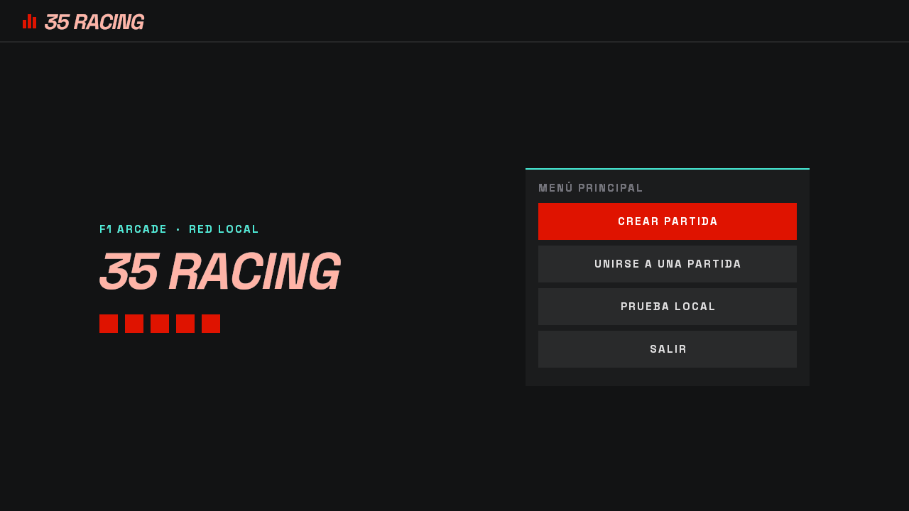
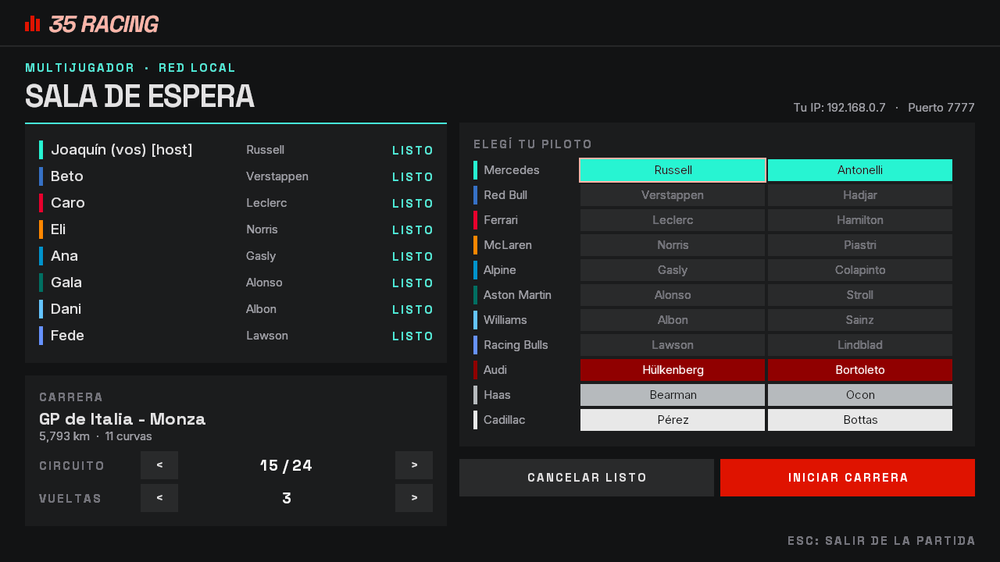
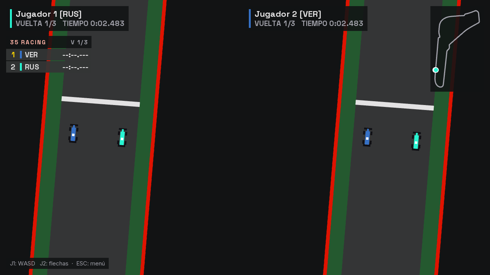
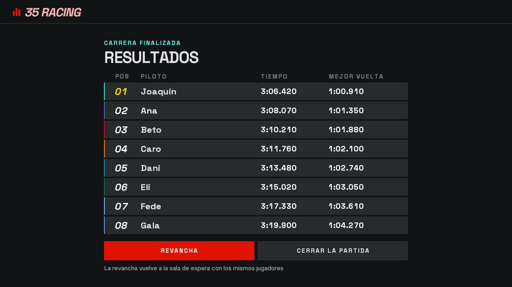

# Etapa 11: Estética tipo F1

## Objetivo

Cambiar la estética de la app a una estética tipo F1: fondo oscuro, tarjetas rectas con una línea de color de la escudería, tipografía deportiva, rojo para lo principal y primer puesto en dorado. Es la primera de seis etapas: después siguen hasta 8 jugadores, mapa en vivo, bots, clasificación y torneos.

Se hizo primero porque esas etapas agregan opciones a la sala de espera. Si la estética quedaba para el final, la sala se habría rehecho dos veces.

## Qué se hizo

| Pieza | Qué cambió |
|---|---|
| `Config` | La interfaz pasa a 1280x720 (`ANCHO_INTERFAZ`, `ALTO_INTERFAZ`) y el mundo sigue en 640x360 (`ANCHO_MUNDO`, `ALTO_MUNDO`, antes `ANCHO_VIRTUAL` y `ALTO_VIRTUAL`) |
| `PantallaBase` | Barra superior con la marca y piezas comunes: `titular`, `tarjeta`, `boton`, `botonPrimario` y `textoLargo`. Se saca el marco de bandera a cuadros |
| `Paleta`, `Recursos`, `FondoConLinea` | Colores, fuentes (Space Grotesk e Inter) y estilos nuevos |
| `MenuPrincipal`, `UnirsePartida`, `PruebaLocal`, `Lobby`, `Resultados` | Rearmadas con esas piezas. La lógica de red de cada una no cambió |
| `PantallaCarrera`, `TorreHud` | Panel del jugador y torre de tiempos con los estilos nuevos |
| `VistaCircuito` | Solo los colores: fondo, pasto, asfalto, muro y meta salen de `Paleta`. La forma y la colisión no se tocaron |
| `tools/fuentes/generar_fuentes.py` | Genera las fuentes como imagen más archivo `.fnt`, así no hace falta agregar dependencias |
| `tools/interfaz/CapturaPantallas.java` | Recorre las pantallas del juego real y guarda capturas |

## Verificación

- El proyecto compila (`gradlew lwjgl3:classes`).
- `CapturaPantallas` recorrió las 12 capturas sin errores.
- La sala y la carrera se probaron con el servidor real y dos clientes en la misma PC.

**Sin verificar:** no se probó entre dos PC.

Las capturas son de un estado posterior, con el pasto ya ajustado (etapa 12), hasta 8 jugadores y el mapa de la etapa 13.

| Menú | Sala de espera |
|---|---|
|  |  |

| Carrera con pantalla dividida | Resultados |
|---|---|
|  |  |

## Commits y PR

Rama `feature/estetica-pitwall`. Todo lo de las etapas 11 a 16 quedó junto, en la rama `feature/estetica-pitwall`, porque esas etapas tocan los mismos archivos: `de4678c` (código, recursos y pruebas) y `0d74733` (documentación). Entró a `main` con los PR [#15](https://github.com/joakinkong/35-Racing/pull/15) y [#16](https://github.com/joakinkong/35-Racing/pull/16), y a `develop` con el [#17](https://github.com/joakinkong/35-Racing/pull/17).
