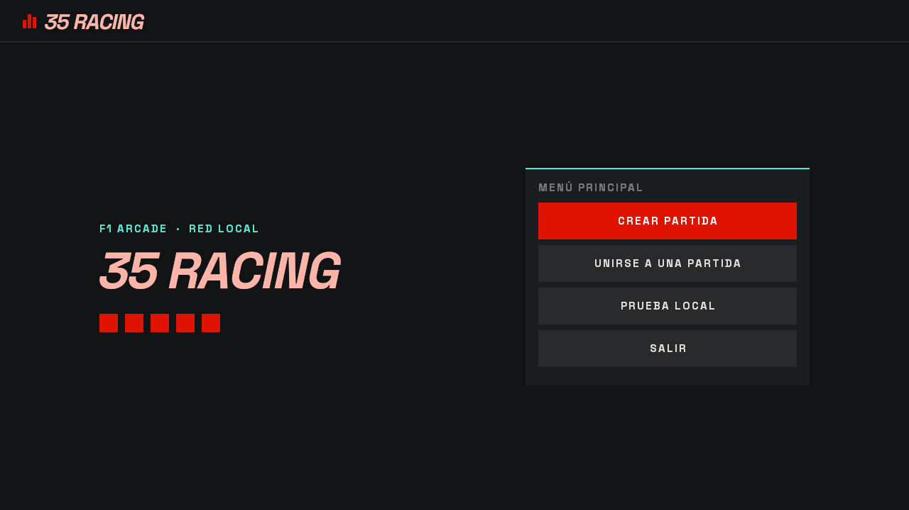
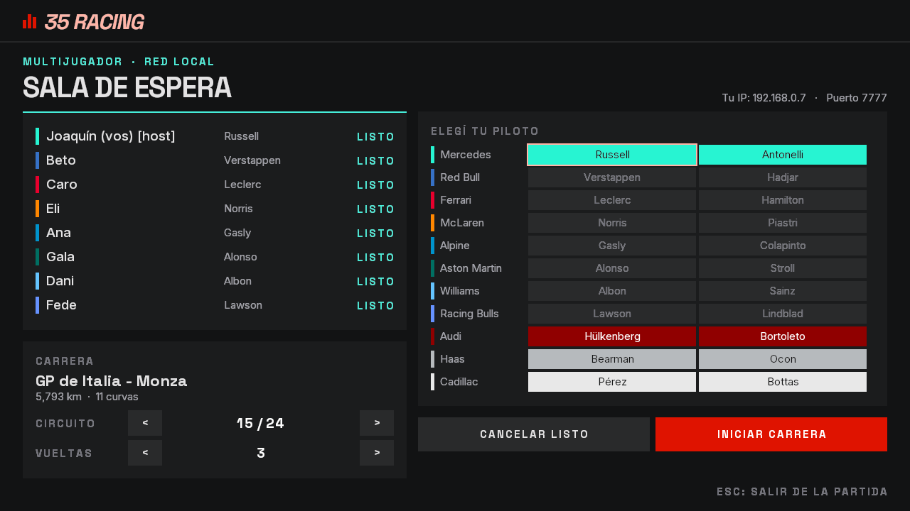
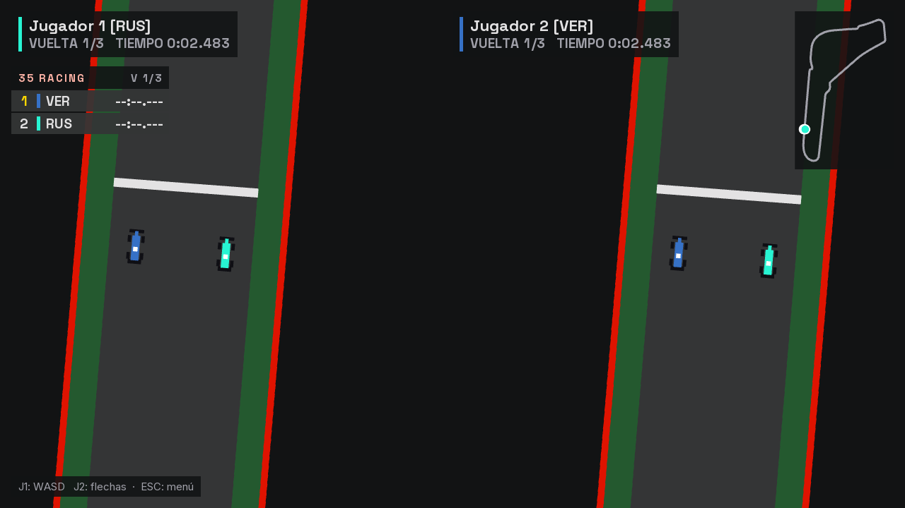
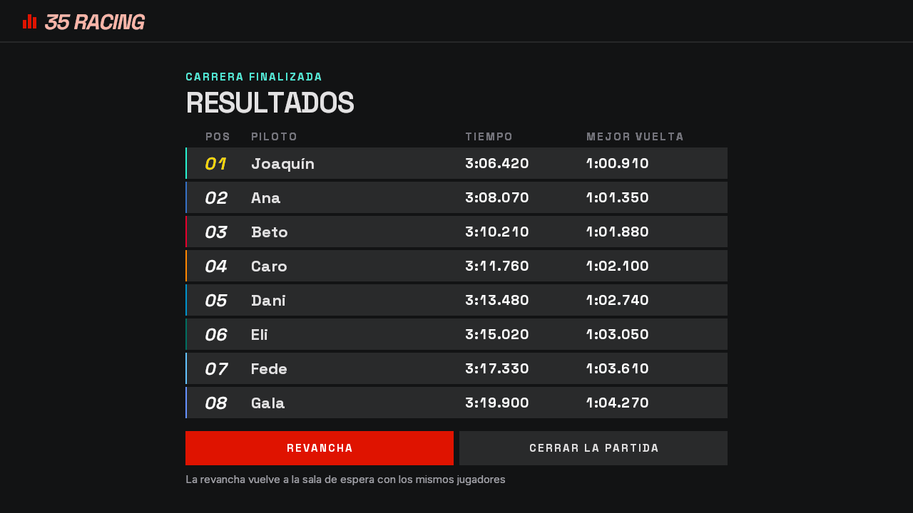

# Etapa 11: Estética de PIT WALL

## Objetivo

Que todo el juego copie la estética de PIT WALL, la página de estadísticas de Fórmula 1 de Joaquín (<https://joakinkong.github.io/Pitwall-F1/>), porque la idea es sumar el juego a esa página como minijuego cuando el proyecto termine. Es la primera de seis etapas: después siguen hasta 8 jugadores, mapa en vivo, bots, clasificación y torneos.

Se hizo primero porque esas etapas agregan opciones a la sala de espera. Si la estética quedaba para el final, la sala se habría rehecho dos veces.

## Qué se tomó de la página

Los valores salen del código de la página (`docs/index.html` y `docs/css/styles.css` de ese proyecto), no de una estimación a ojo.

| Elemento | En PIT WALL | En el juego |
|---|---|---|
| Fondo | `#121314` | `Paleta.FONDO` |
| Superficies | `#0d0e0f`, `#1b1c1d`, `#292a2b`, `#343536` | `Paleta.SUPERFICIE_*` |
| Marca y lo activo | Salmón `#ffb4a7` | `Paleta.PRIMARIO` |
| Etiquetas de sección | Turquesa `#47efda` | `Paleta.SECUNDARIO` y el estilo `seccion` |
| Rojo | `#df1300` | `Paleta.ROJO`: botón principal y luces |
| Tipografía | Space Grotesk (títulos y datos) e Inter (texto) | Las mismas, en `assets/fuentes` |
| Esquinas | Rectas | Rectas |
| Tarjetas | Línea de color arriba o franja de la escudería a la izquierda | `FondoConLinea` |
| Primer puesto | Número en cursiva, dorado | Igual, en `Resultados` y `TorreHud` |

## Qué se hizo

| Pieza | Qué cambió |
|---|---|
| `Config` | `ANCHO_VIRTUAL` y `ALTO_VIRTUAL` pasan a llamarse `ANCHO_MUNDO` y `ALTO_MUNDO`, y siguen en 640x360. Se agregan `ANCHO_INTERFAZ` y `ALTO_INTERFAZ` (1280x720) |
| `PantallaBase` | Escena a 1280x720, barra superior con la marca y piezas comunes: `titular`, `tarjeta`, `boton`, `botonPrimario` y `textoLargo`. Se saca el marco de bandera a cuadros |
| `Paleta`, `Recursos`, `FondoConLinea` | Colores, fuentes y estilos nuevos |
| `MenuPrincipal`, `UnirsePartida`, `PruebaLocal`, `Lobby`, `Resultados` | Rearmadas con esas piezas. La lógica de red de cada una no cambió |
| `PantallaCarrera`, `TorreHud` | Panel del jugador y torre de tiempos con los estilos nuevos, a la nueva escala |
| `VistaCircuito` | Solo los colores: fondo, pasto, asfalto, muro y meta salen de `Paleta`. La forma y la colisión no se tocaron |
| `tools/fuentes/generar_fuentes.py` | Genera las fuentes (ver abajo) |
| `tools/interfaz/CapturaPantallas.java` | Recorre las pantallas del juego real y guarda capturas |

## Decisiones

**Dos resoluciones.** La interfaz a 640x360 agrandada al doble no daba texto nítido, pero cambiar la cámara de la carrera habría cambiado lo que se ve de la pista y, con eso, cómo se maneja. Por eso son independientes: la interfaz está a 1280x720 y el mundo sigue en 640x360.

**Fuentes generadas, sin dependencias.** `CLAUDE.md` pide no agregar dependencias sin preguntar, y la alternativa era `gdx-freetype`. Se eligió generar una vez cada tamaño como imagen más un archivo `.fnt`, un formato que LibGDX ya lee. El generador es un script de Python con Pillow, que solo hace falta para cambiar un tamaño: el juego no lo necesita para correr. En contra: cada tamaño nuevo requiere volver a generar. Los `.ttf` no quedan en el repositorio; sí las imágenes y las dos licencias OFL.

**Cursiva inclinada a mano.** Space Grotesk no tiene cursiva real: el navegador inclina las letras al mostrar "PIT WALL". El generador hace lo mismo, con una inclinación de 0,21.

**Dígitos de ancho fijo.** En los estilos `numeros` y `posicion`, todos los dígitos ocupan lo mismo. Si no, los tiempos del HUD temblarían al cambiar cada dígito. La página logra lo mismo con `tabular-nums`.

## Problemas y cómo se resolvieron

| Problema | Causa | Solución |
|---|---|---|
| El dorado y el salmón de la torre salían apagados | `Label` multiplica su color por el del estilo, y el estilo ya era gris | Los estilos `numeros` y `posicion` son blancos y se tiñen según el dato; "35 RACING" tiene su propio estilo `marcaChica` |
| Las capturas de carrera mostraban siempre el "3" de la cuenta regresiva | La ventana oculta corría sin tope de cuadros, y 240 cuadros duraban menos de un segundo | El programa de capturas corre a 60 cuadros por segundo |

## Verificación

- El proyecto compila (`gradlew lwjgl3:classes`).
- `CapturaPantallas` recorrió las 12 capturas sin errores: menú, menú con aviso, crear, unirse, prueba local, sala con 2 jugadores, sala con todos listos, cuenta regresiva, carrera en red, resultados en red, resultados locales y carrera con pantalla dividida.
- La sala y la carrera se probaron con el servidor real y dos clientes en la misma PC: los jugadores aparecen, se elige piloto, se marca "listo", se inicia y el tiempo de carrera corre.
- Las letras con acento y otros signos se ven bien, por ejemplo "São Paulo" y "Hülkenberg".
- `CARRERA FINALIZADA`, el cartel más largo, mide 901 px sobre los 1280 de ancho: entra.

Joaquín revisó el resultado y pidió un solo ajuste, un verde más fuerte para el pasto, que se hizo en la [etapa 12](12-hasta-ocho-jugadores.md). El fondo negro alrededor de la pista queda así por ahora: más adelante se piensa agregar gradas.

**Sin verificar:** no se probó entre dos PC.

Las capturas son de un estado posterior, con el pasto ya ajustado, hasta 8 jugadores y el mapa de la etapa 13.

| Menú | Sala de espera |
|---|---|
|  |  |

| Carrera con pantalla dividida | Resultados |
|---|---|
|  |  |

## Uso de IA

El código, el generador de fuentes y esta documentación los escribió Claude (Claude Code) a pedido de Joaquín, que definió el objetivo y aprobó el plan y las decisiones.

## Commits y PR

Rama `feature/estetica-pitwall`. Todo lo de las etapas 11 a 16 quedó junto, en la rama `feature/estetica-pitwall`, porque esas etapas tocan los mismos archivos: `de4678c` (código, recursos y pruebas) y `0d74733` (documentación). Entró a `main` con los PR [#15](https://github.com/joakinkong/35-Racing/pull/15) y [#16](https://github.com/joakinkong/35-Racing/pull/16), y a `develop` con el [#17](https://github.com/joakinkong/35-Racing/pull/17).
