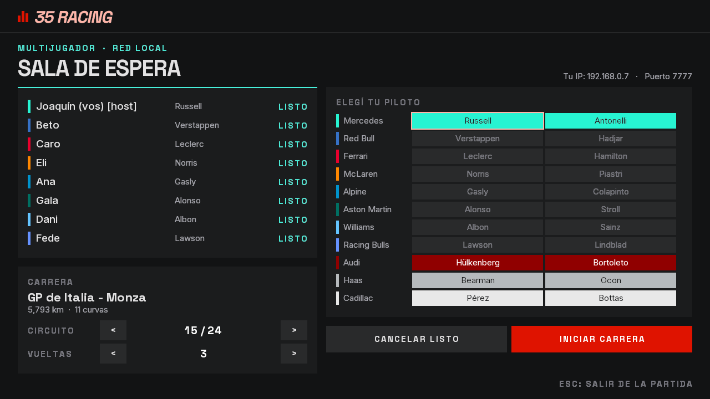
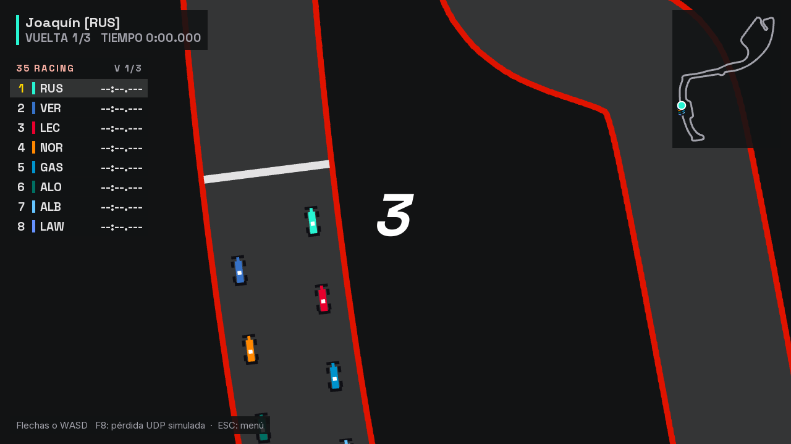

# Etapa 12: Hasta 8 jugadores

## Objetivo

Que entren hasta 8 jugadores en una misma partida, en lugar de 5. También es la base de la etapa de bots, que van a ocupar los lugares libres de la grilla.

Este cambio se aparta de la propuesta original del proyecto, que dejaba fuera del alcance "más de cinco jugadores por partida". La propuesta no se modificó porque es el documento que se presentó en su momento.

## Qué se hizo

| Pieza | Qué cambió |
|---|---|
| `Config` | `MAX_JUGADORES` pasa de 5 a 8, y `VERSION_PROTOCOLO` de 3 a 4 |
| `PaquetesUdp` | `LARGO_MAXIMO` se calcula con `Config.MAX_JUGADORES`. Antes tenía un 5 escrito a mano: el búfer de recepción era de 196 bytes (132 + 64 de margen), así que un `ESTADO` con 8 autos, de 204 bytes, habría llegado cortado y se habría descartado. Con 8 jugadores, nadie habría visto la carrera |
| `tools/circuitos/generar_circuitos.py` | Genera 8 lugares de largada |
| `assets/circuitos` | Los 24 circuitos, con los lugares 6, 7 y 8 |
| `PruebaCircuitos` | Comprueba los 8 lugares y agrega un control nuevo: dos lugares no pueden quedar encimados |
| `CapturaPantallas` | Ahora prueba una partida llena: 8 clientes de verdad y un noveno que tiene que quedar afuera |
| `docs/PROTOCOLO.md` | Límites y cuenta de ancho de banda para 8 jugadores |
| `Paleta` | El pasto pasa de `#1F3D2B` a `#24592F`, pedido por Joaquín al revisar la etapa 11 |

La sala de espera y la torre de tiempos no necesitaron cambios de código: arman sus filas según `MAX_JUGADORES` y la cantidad de autos. Se revisó que entraran en pantalla.

## Decisiones

**Los circuitos se regeneraron, pero comprobando que no cambiara el trazado.** La forma de los circuitos es sensible: en la etapa 10 ya hubo que deshacer un cambio que había empeorado Mónaco. Por eso primero se generaron en una carpeta temporal y se compararon campo por campo con los actuales. En los 24, lo único distinto son los lugares de largada nuevos, y los 5 que ya existían quedaron idénticos. Recién entonces se reemplazaron.

**Se subió la versión del protocolo.** El formato de los mensajes es el mismo, pero un cliente de versión 3 descartaría los datos de los jugadores 6 a 8, porque lee hasta 5. Con la versión nueva, ese cliente recibe un `VERSION_DISTINTA` claro en lugar de ver una partida incompleta.

## El costo en la red

Con 8 autos, cada `ESTADO` pasa de 132 a 204 bytes (12 de cabecera más 24 por auto), muy por debajo de los 1.472 que entran en un paquete de Ethernet sin fragmentarse.

| | 5 jugadores | 8 jugadores |
|---|---|---|
| `ESTADO` con cabeceras | 160 bytes | 232 bytes |
| Recibe cada cliente | 4.800 bytes/s | 6.960 bytes/s |
| Salen del host | 19.200 bytes/s | 48.720 bytes/s |
| Entran al host | 9.360 bytes/s | 16.380 bytes/s |
| **Total en el host** | **0,23 Mbit/s** | **0,52 Mbit/s** |

Es el 0,52 % de una red de 100 Mbit/s. Estos números salen de la cuenta, no de una medición en una red real.

## Verificación

| Prueba | Resultado |
|---|---|
| Comparación de los circuitos regenerados | 24 de 24 sin diferencias fuera de los lugares 6 a 8 |
| `PruebaCircuitos`, con los 8 lugares | `TODOS OK`: ninguno toca el muro ni queda encimado |
| 8 clientes en una partida, en Mónaco, con 7 acelerando | Cada uno de los 7 clientes de prueba recibió 197 estados, y el último traía los 8 autos |
| Un noveno jugador intenta entrar | El servidor lo rechaza con `PARTIDA_LLENA` |
| Capturas de sala, grilla, carrera y resultados con 8 | Todo entra en pantalla |

**Sin verificar:** las pruebas corrieron con todos los clientes en una sola PC, así que los paquetes no pasaron por una red real. Sigue pendiente probar con varias PC, y ahora con hasta 8.

| Sala con 8 jugadores | Grilla de largada en Mónaco |
|---|---|
|  |  |

## Uso de IA

El código y esta documentación los escribió Claude (Claude Code) a pedido de Joaquín, que definió el objetivo y aprobó el plan.

## Commits y PR

Todo lo de las etapas 11 a 16 quedó junto, en la rama `feature/estetica-pitwall`, porque esas etapas tocan los mismos archivos: `de4678c` (código, recursos y pruebas) y `0d74733` (documentación). Entró a `main` con los PR [#15](https://github.com/joakinkong/35-Racing/pull/15) y [#16](https://github.com/joakinkong/35-Racing/pull/16), y a `develop` con el [#17](https://github.com/joakinkong/35-Racing/pull/17).
