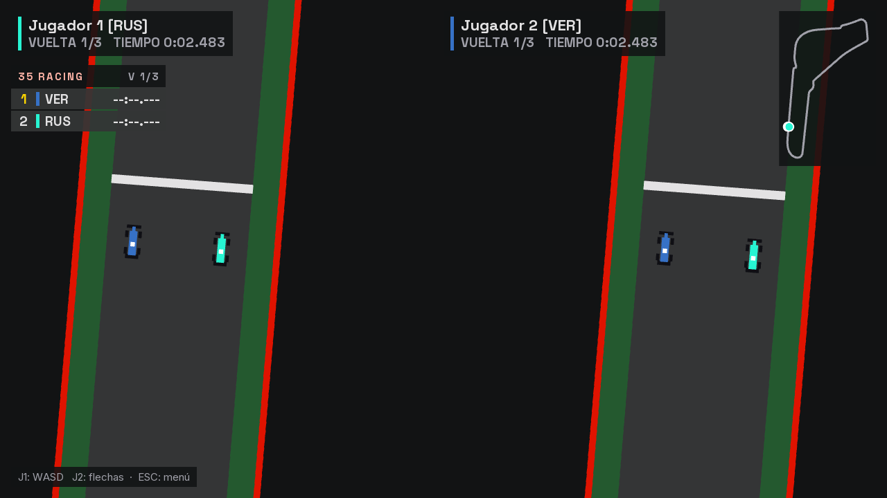

# Etapa 13: Mapa en vivo

## Objetivo

Agregar al HUD de la carrera un mapa del circuito en tiempo real, arriba a la derecha: el trazado completo y un punto del color de cada auto.

## Qué se hizo

| Pieza | Qué cambió |
|---|---|
| `vista/MiniMapa` (nueva) | Dibuja el panel, el trazado, la meta y un punto por auto |
| `Recursos` | Una textura nueva con un círculo de borde suave, para los puntos |
| `PantallaCarrera` | Suma el mapa a la escena y le pasa la foto de la carrera en cada cuadro |
| `CapturaPantallas` | Captura el mapa en más circuitos y guarda las imágenes sin transparencia (ver "Problemas") |

## Decisiones

**No se tocó la red.** Cada `ESTADO` ya trae la posición de todos los autos, porque el cliente los necesita para dibujarlos. El mapa lee esa misma foto, así que no agrega ningún byte ni cambia el protocolo. Es la ventaja de que el servidor mande el estado completo en un solo paquete.

**Cada circuito define la forma del panel.** El lado más largo del trazado mide 200 px y el otro se ajusta para no deformarlo: Mónaco y Monza quedan altos y angostos, y Las Vegas y Suzuka, anchos. El panel usa la línea central y no el tamaño total del mapa, para que el trazado no quede con márgenes desparejos.

**El trazado se calcula una sola vez.** Se usa una muestra cada 3 px de pantalla, aproximadamente, porque los circuitos tienen unas 2.000 muestras y a esta escala varias caerían en el mismo píxel. La cantidad de muestras que se saltean se calcula para cada circuito.

**Los autos de esta PC se distinguen.** Su punto es más grande, lleva borde blanco y se dibuja último, para que nunca quede tapado. El resto lleva un borde oscuro que los separa del trazado. Eso también ayuda con los colores más oscuros, como los de Audi y Aston Martin.

**Se dibuja en la escena de la interfaz, no en el mundo.** Por eso aparece una sola vez aunque la pantalla esté dividida, y nunca se superpone con el panel del segundo jugador: ese panel termina en x = 960 y el mapa más ancho arranca en x = 1040.

## Problemas y cómo se resolvieron

| Problema | Causa | Solución |
|---|---|---|
| En las capturas, los paneles del HUD se veían grises y más claros de lo debido | Los paneles semitransparentes también bajan el canal alfa de la ventana. En pantalla no se nota, pero el PNG guardaba esa transparencia y el visor la mostraba sobre blanco. El juego estaba bien; las capturas de las etapas 11 y 12 tenían ese defecto | `CapturaPantallas` fuerza el alfa a opaco antes de guardar |

## Verificación

- El proyecto compila y `CapturaPantallas` terminó sin errores, con 16 capturas.
- Se revisó el mapa en Mónaco, Monza, Suzuka y Las Vegas: el trazado se reconoce y queda dentro del panel. También se capturaron Spa y Hungaroring, sin revisión detallada.
- En la carrera en red con 8 clientes, el punto del auto que avanzó quedó adelante de la meta, y el del host, que no aceleró, se quedó en su lugar de largada.
- Con la pantalla dividida hay un solo mapa, y no pisa ningún panel.

**Sin verificar:**
- **Puntos separados:** en estas pruebas los autos quedaron todos juntos, porque los clientes de prueba solo aceleran y chocan en la primera curva. Se comprobó después, en la [etapa 14](14-bots.md), con bots dando vueltas.
- **Grilla:** al largar, los puntos se tapan entre sí. Los lugares de largada están a pocos píxeles en el mapa, y es un efecto esperable de la escala.
- **Red real:** no se probó entre varias PC.

## Uso de IA

El código y esta documentación los escribió Claude (Claude Code) a pedido de Joaquín, que definió el objetivo y aprobó el plan.

## Commits y PR

Se completa al commitear.
