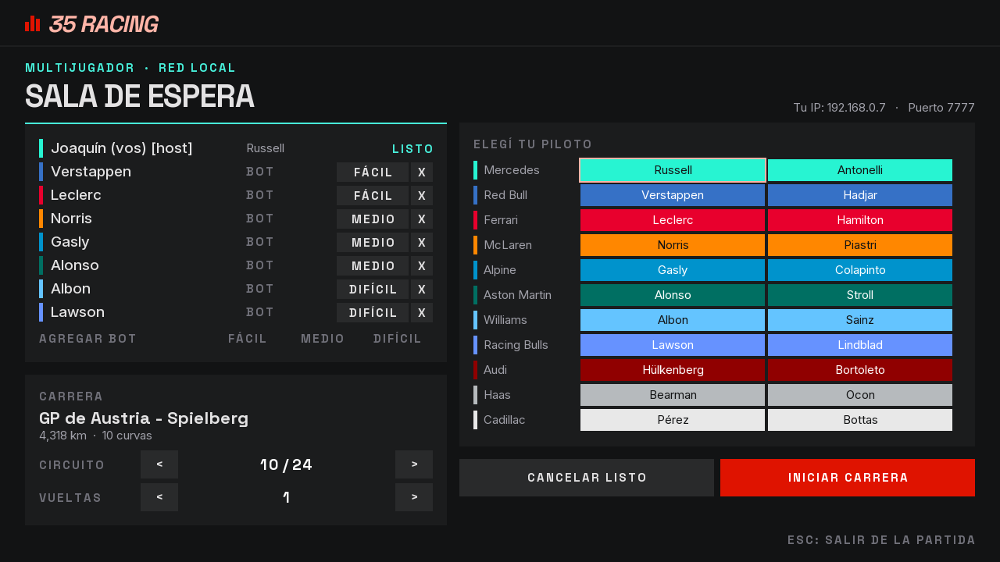
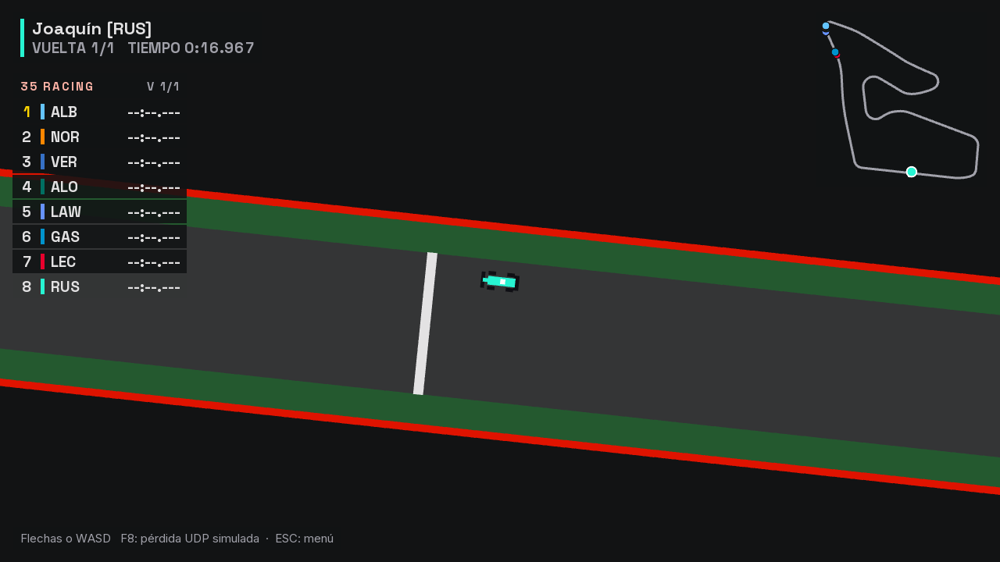

# Etapa 14: Bots con niveles de dificultad

## Objetivo

Que el host pueda completar la grilla con bots, hasta 8 autos, eligiendo la dificultad de cada uno: fácil, medio o difícil. Joaquín pidió que al difícil sea casi imposible ganarle.

Como la etapa 12, esto se aparta de la propuesta original, que dejaba fuera del alcance los "rivales controlados por inteligencia artificial". La propuesta no se modificó.

## Qué se hizo

| Pieza | Qué hace |
|---|---|
| `juego/NivelBot` (nueva) | Los tres niveles y sus valores |
| `juego/RecorridoBot` (nueva) | Calcula una vez, al iniciar la carrera, el camino y la velocidad deseada en cada punto del circuito |
| `juego/PilotoBot` (nueva) | En cada paso mira el auto y arma una `EntradaAuto`: sigue el camino, esquiva autos, sale de reversa si queda trabado y, según el nivel, se equivoca |
| `ServidorPartida` | Los bots son jugadores sin conexión. Mensajes nuevos, reglas de la sala y grilla con las personas adelante |
| `EstadoLobby`, `Protocolo`, `ClientePartida` | Campo `nivelBot` en el `LOBBY` y mensajes `AGREGAR_BOT`, `QUITAR_BOT` y `NIVEL_BOT`. Protocolo versión 5 |
| `Lobby` | Botones para agregar por nivel; en cada bot, cambio de nivel y una X para quitarlo |
| `tools/bots` (nueva) | `PruebaBots` y `PruebaSalaBots` |

## Decisiones

**Un bot usa los mismos controles que una persona.** `PilotoBot` solo puede producir una `EntradaAuto`: acelerar, frenar e izquierda o derecha. No toca la posición ni la velocidad, y para `Carrera` no hay diferencia con una entrada que llegó por UDP. El nivel difícil es rápido porque nunca falla y calcula el camino de antemano, no porque tenga un auto mejor.

**Los bots corren en el servidor y no agregan tráfico.** Un bot es un `Jugador` sin `Cliente`: no tiene socket y sus entradas se calculan en el hilo de simulación, el único que toca el estado de la partida. Por eso no hizo falta ninguna sincronización nueva. Su auto ya viaja dentro del `ESTADO`, que tiene el mismo tamaño con 8 autos sean personas o bots. Un bot incluso baja el tráfico, porque el host le manda un `ESTADO` menos y recibe menos `ENTRADA`.

**El camino se calcula, no se dibuja a mano.** La trazada ideal se busca como una banda elástica rígida: cada punto se corre de costado dentro de la pista hasta donde la línea queda menos doblada. Eso funciona igual en los 24 circuitos y en cualquiera que se agregue. La velocidad sale de lo que permiten las gomas en cada curva, con una pasada hacia adelante (lo que da el motor) y otra hacia atrás (llegar frenado).

**Las personas tienen prioridad sobre los bots.**
- Si la sala está llena y entra una persona, sale el último bot.
- Una persona puede elegir la escudería de un bot, y el bot se pasa a la primera libre. Su nombre es el apellido del piloto, así que también cambia.
- Sin clasificación, las personas largan adelante de los bots.

**Solo el host maneja los bots.** El servidor lo comprueba, y `QUITAR_BOT` y `NIVEL_BOT` ignoran un id que no sea de un bot: esos mensajes nunca pueden echar a una persona.

**Se puede jugar una persona contra bots.** `MIN_JUGADORES` ahora cuenta autos.

## Cómo se calibraron los niveles

La primera versión del difícil no alcanzaba: chocaba y el medio le ganaba en 16 de 24 circuitos. Medir la vuelta teórica mostró por qué. En estos circuitos, las curvas son abiertas para la escala del auto y se va casi siempre cerca de la velocidad máxima (media de unos 400 px/s sobre 450):

- Cambiar el agarre que usa en las curvas casi no movía el tiempo.
- Lo que hacía perder tiempo eran los golpes en los circuitos callejeros: en Bakú, 12 segundos por vuelta.

Se probaron combinaciones con `PruebaBots` y estos fueron los cambios:

| Ajuste | Efecto |
|---|---|
| Más distancia al borde de la pista (de 6 a 12 px) | El difícil pasa a tener 0 golpes contra el muro en los 24 circuitos y baja su media de 57,1 a 55,9 s |
| Tope de velocidad en fácil (90 %) y medio (94 %) | Separa los niveles. Como la vuelta depende sobre todo de la recta, es lo que más pesa |
| Bajar solo si tiene al otro justo adelante | Deja de seguir detrás del que ya está pasando. Junto con el tope de velocidad, hace que el difícil pase de ganar 8 a ganar 22 de 24 carreras; no se midieron por separado |

Resultado en los 24 circuitos, con 3 vueltas (con la variación de ritmo que se sumó al difícil en la [etapa 15](15-clasificacion.md)):

| Nivel | Mejor vuelta media | Golpes al muro, solo | Sin terminar, solo |
|---|---|---|---|
| Fácil | 69,17 s | 0 | 0 de 24 |
| Medio | 60,62 s | 0 | 0 de 24 |
| Difícil | 55,87 s | 0 | 0 de 24 |

El bot de calibración de la etapa 10, que sigue el centro de la pista, daba 60,9 s de media.

En una carrera de 8 bots (3 fáciles, 3 medios y 2 difíciles, con los difíciles en los lugares 4 y 7 de la grilla), **ganó un difícil en 22 de 24 circuitos**. En la mayoría terminan 5 de los 8: los fáciles quedan afuera porque el cierre de 30 segundos los corta. Es la regla normal de la carrera, y en la tabla quedan ordenados por lo que avanzaron.

## Límites conocidos

- **Falta medirlo contra personas.** El tiempo del difícil está a pocos segundos del teórico: en Hungaroring, 50,3 s contra 48,4 s, medido antes de los últimos ajustes. No se sabe todavía cuánto tarda una persona, así que "casi imposible" es lo esperado y no algo comprobado. Los valores se ajustan en `NivelBot`.
- **El tráfico le cuesta.** Pasar a un auto no le hace perder tiempo (se midió, con 109,0 s solo y 109,1 s detrás de un fácil, en 2 vueltas). Largar último de 8 sí: 120,8 s de media en esas mismas 2 vueltas, un 11 % más. En una carrera de una vuelta, un difícil que larga último puede perder contra un medio que larga adelante. Pasó en una prueba en Spielberg, donde dos medios le ganaron; en otra, con la misma grilla, ganó un difícil con 49,9 s. Con la clasificación de la próxima etapa, en general va a largar más adelante.
- **Autos parados:** un auto que terminó la carrera se frena solo sobre la pista, como pasa con las personas desde la etapa 4, y los bots lo esquivan como a cualquier otro.

## Problemas y cómo se resolvieron

| Problema | Solución |
|---|---|
| "CARRERA FINALIZADA" se pisaba con la torre de tiempos cuando había muchos autos | Ese cartel se dibuja al 70 % |
| Con 8 filas de jugadores, la fila para agregar bots no entraba en la sala | Las filas pasaron de 34 a 30 px |

## Verificación

- `PruebaBots`: los números de arriba.
- `PruebaSalaBots`, contra el servidor real y clientes por TCP: `TODO OK` en sus 20 comprobaciones. Incluye que un noveno auto se rechaza, que una persona desplaza a un bot, que un invitado no puede tocar los bots, que `QUITAR_BOT` no echa a una persona, que una persona sola no puede iniciar y que una carrera de persona contra bot llega a los resultados y a la revancha.
- `CapturaPantallas`: una partida de una persona contra 7 bots en Spielberg, desde la sala hasta los resultados. Terminaron los 7 bots, y en el mapa se los ve repartidos por el circuito, lo que quedaba pendiente de la etapa 13.

**Sin verificar:** ninguna persona jugó contra los bots todavía, y no se probó entre varias PC.

| Sala con bots | Carrera con bots |
|---|---|
|  |  |

## Uso de IA

El código y esta documentación los escribió Claude (Claude Code) a pedido de Joaquín, que definió el objetivo, pidió los niveles de dificultad y aprobó el plan.

## Commits y PR

Todo lo de las etapas 11 a 16 quedó junto, en la rama `feature/estetica-pitwall`, porque esas etapas tocan los mismos archivos: `de4678c` (código, recursos y pruebas) y `0d74733` (documentación). PR pendiente.
