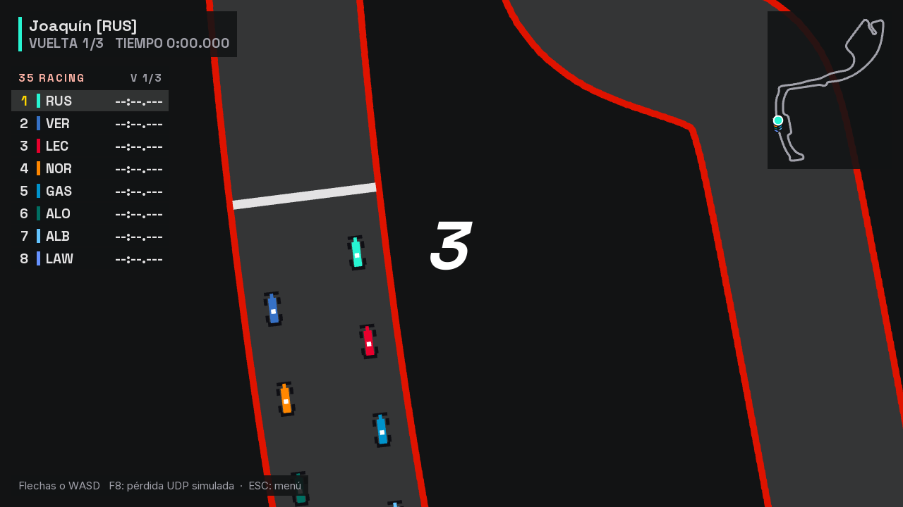
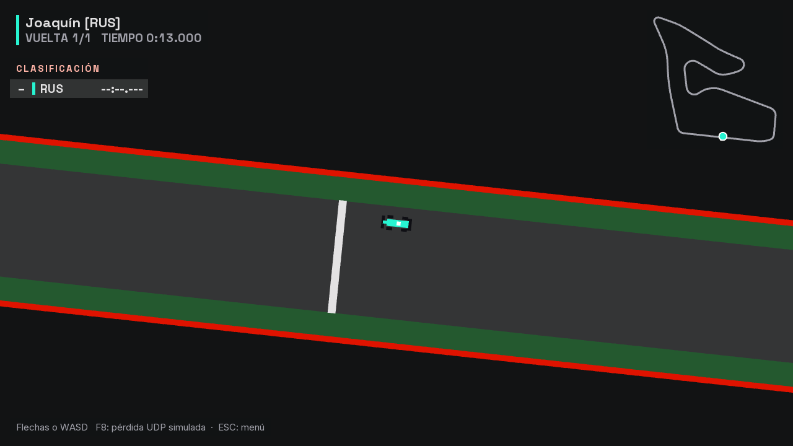
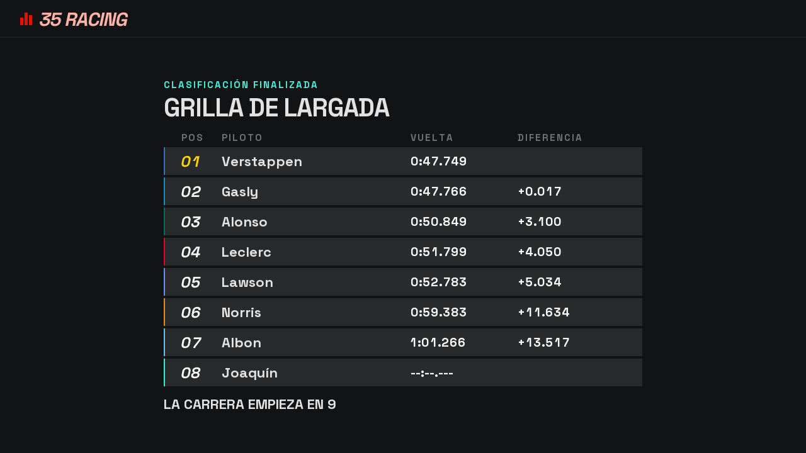

# Etapa 15: Clasificación

## Objetivo

Que al crear una sala se pueda elegir si hay clasificación antes de la carrera. Cada jugador da una sola vuelta y el orden de los tiempos arma la grilla: el más rápido larga primero, como en la Fórmula 1.

En la misma tanda se escalonó la grilla de largada, también pedido por Joaquín al probar la etapa 14.

## Qué se hizo

| Pieza | Qué cambió |
|---|---|
| `Carrera` | Un modo clasificación: todos salen del primer lugar de la grilla, sin choques entre autos y con un cierre de 60 s en lugar de 30 |
| `ServidorPartida` | Una fase nueva, `GRILLA`. Con clasificación, el recorrido es sala, clasificación, grilla, carrera y resultados |
| `Protocolo`, `EstadoLobby` | `ELEGIR_CLASIFICACION`, `GRILLA`, un campo nuevo en `LOBBY` y otros en `CUENTA_REGRESIVA`. Protocolo versión 6 |
| `CarreraEnRed` | El lugar de cada auto en la largada ya no sale del orden del lobby, sino de la lista que manda el servidor |
| `PantallaCarrera`, `TorreHud`, `MiniMapa` | En la clasificación solo muestran los autos de esta PC |
| `pantallas/PantallaGrilla` (nueva) | Muestra el resultado con la diferencia con el primero y cuánto falta para largar |
| `Lobby` | Un selector de clasificación. Se sacó el rótulo "CARRERA" y se achicaron los selectores para que siga entrando todo |
| `tools/bots/PruebaClasificacion` (nueva) | Prueba que los autos no se molesten y todo el recorrido de mensajes |
| `tools/circuitos/generar_circuitos.py`, `assets/circuitos` | Grilla escalonada |

## Decisiones

**Todos a la vez, sin verse.** Joaquín pidió que corran al mismo tiempo, cada uno en su pantalla y sin ver a los demás. Se resolvió en dos partes:

- **En el servidor** no hay choques entre autos y todos salen del mismo lugar, así que los tiempos son comparables.
- **En el cliente** se dejan de dibujar los otros autos, en la pista, en el mapa y en la torre de tiempos.

El `ESTADO` sigue trayendo a todos: no se cambió el formato UDP para esto. Un cliente modificado podría ver a los demás, pero en este juego entre compañeros no es un problema que valga la pena resolver.

**Los bots corren igual que las personas.** Durante la clasificación no reciben a los otros autos, así que tampoco los esquivan.

**La carrera arranca sola.** La grilla se muestra 10 segundos (`Config.SEGUNDOS_GRILLA`) y el servidor manda la cuenta regresiva. Así nadie queda esperando al host. Cada PC lleva su propio reloj solo para mostrar cuánto falta; la que manda es la `CUENTA_REGRESIVA`.

**Quien no completa la vuelta larga último.** La regla ya existía en `Carrera`: primero los que terminaron, por tiempo, y después el resto, por lo que avanzaron. El cierre de 60 s es más largo que el de carrera porque un error en la única vuelta no se recupera en la siguiente.

**La grilla se manda de forma explícita.** `CUENTA_REGRESIVA` ahora trae los ids en el orden de largada. Antes cada cliente la deducía del orden del lobby, algo que con clasificación dejaría de ser cierto. Sigue siendo la misma regla del protocolo: lo decide el servidor.

**El difícil con una mínima variación.** En la primera prueba, dos bots difíciles hicieron exactamente 47,816 s y la grilla mostró "+0.000". Como no se equivocan y siguen el mismo camino, siempre empataban. Ahora tienen una variación de ritmo de ±0,2 %. La media del nivel casi no cambió: de 55,92 a 55,87 s.

## Grilla escalonada

Antes los autos largaban de a dos, uno al lado del otro. Ahora, como en la Fórmula 1, cada auto larga un poco más atrás que el anterior: 40 px entre uno y el siguiente, y 80 entre filas.

Se cambió una línea del generador y se regeneraron los 24 circuitos, con el mismo cuidado de la etapa 12: comparados campo por campo, lo único distinto es `largada`, y el primer lugar quedó igual en los 24. `PruebaCircuitos` da `TODOS OK`: ningún lugar toca el muro ni queda encimado con otro.

## Verificación

- `PruebaClasificacion`, `TODO OK` en sus 36 comprobaciones:
  - En Mónaco, Spielberg y Suzuka, 8 bots en pista hacen cada uno exactamente el mismo tiempo que uno solo. Es la prueba de que no se molestan.
  - Contra el servidor real: la clasificación es de una vuelta, todos salen del mismo lugar, el más rápido larga primero, el que no terminó larga último, la carrera larga en el orden de la grilla, llega a los resultados y la revancha conserva la opción.
- `PruebaSalaBots` y `PruebaBots` siguen pasando. El difícil gana 22 de 24 carreras.
- `CapturaPantallas`: una persona contra 7 bots en Spielberg, por la sala, la vuelta sin ver a nadie, la grilla y la largada. La carrera largó en el orden de la grilla.

**Sin verificar:** no se probó entre varias PC, ni con dos personas de verdad clasificando a la vez. Tampoco se probó que una persona se desconecte durante la grilla: el código la saca de la largada, pero ninguna prueba cubre ese caso.

| Vuelta de clasificación | Grilla de largada |
|---|---|
|  |  |

## Uso de IA

El código y esta documentación los escribió Claude (Claude Code) a pedido de Joaquín, que definió cómo funciona la clasificación y aprobó el plan.

## Commits y PR

Todo lo de las etapas 11 a 16 quedó junto, en la rama `feature/estetica-pitwall`, porque esas etapas tocan los mismos archivos: `de4678c` (código, recursos y pruebas) y `0d74733` (documentación). Entró a `main` con los PR [#15](https://github.com/joakinkong/35-Racing/pull/15) y [#16](https://github.com/joakinkong/35-Racing/pull/16), y a `develop` con el [#17](https://github.com/joakinkong/35-Racing/pull/17).
