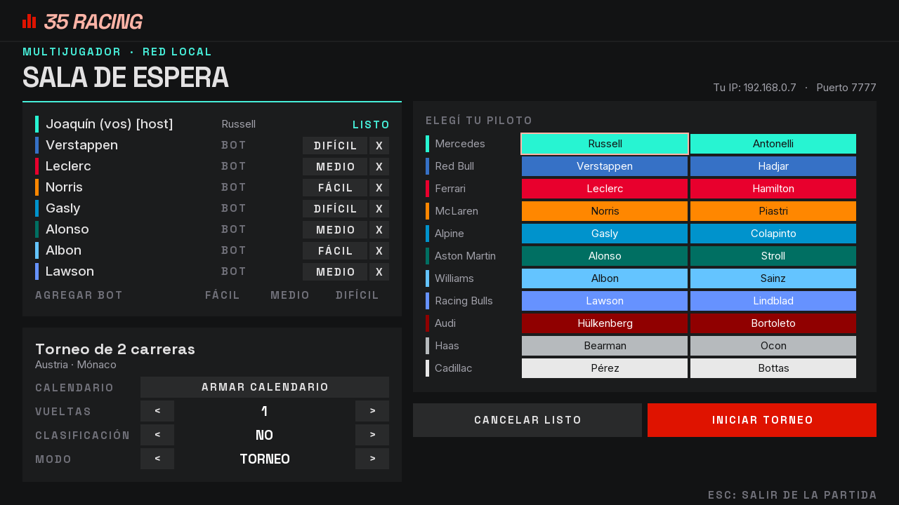
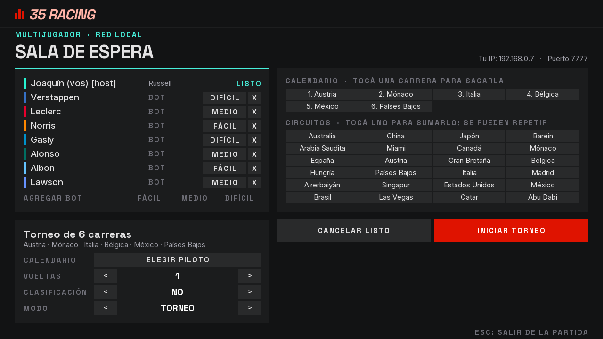
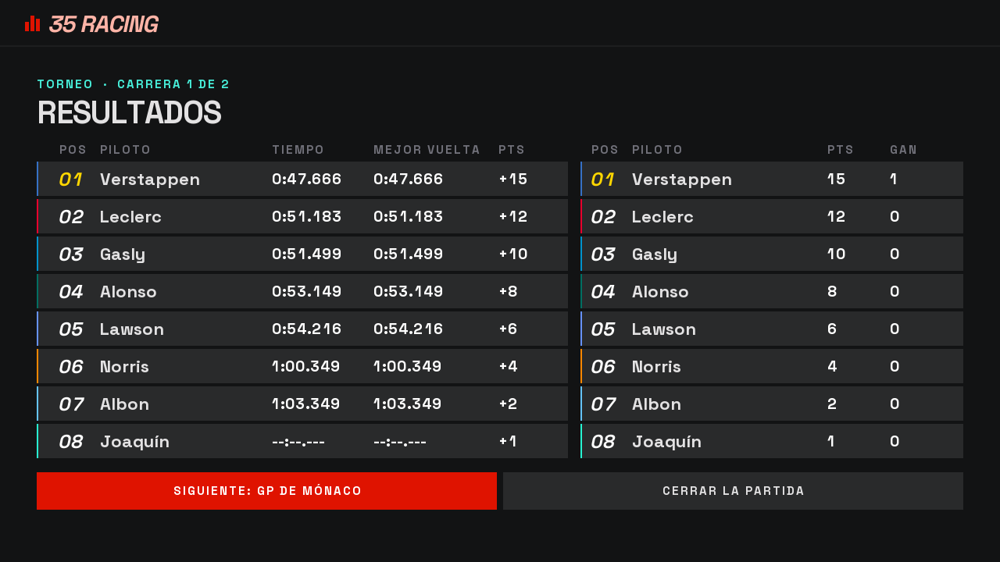
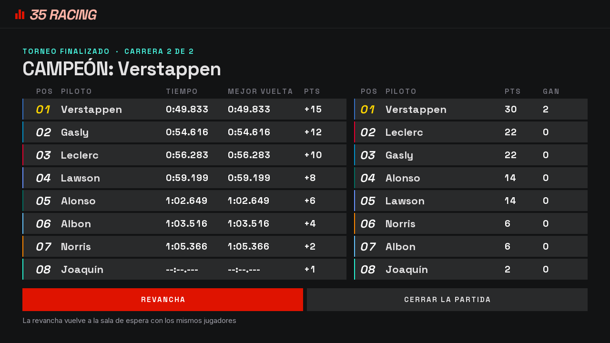

# Etapa 16: Torneos

## Objetivo

Que en la sala se pueda elegir entre una carrera única y un torneo: varias carreras seguidas, en los circuitos que quiera el host y en la cantidad que quiera, acumulando puntos.

Joaquín pidió los puntos "como la F1, pero al revés": el último siempre suma 1 y de ahí para arriba. Dio dos ejemplos, 2-1 con 2 autos y 6-4-2-1 con 4. Los dos coinciden con la tabla de la F1 (25, 18, 15, 12, 10, 8, 6, 4, 2, 1) leída desde el final: 1, 2, 4, 6, 8, 10, 12, 15.

| Autos que largan | Puntos, del primero al último |
|---|---|
| 2 | 2, 1 |
| 3 | 4, 2, 1 |
| 4 | 6, 4, 2, 1 |
| 8 | 15, 12, 10, 8, 6, 4, 2, 1 |

## Qué se hizo

| Pieza | Qué cambió |
|---|---|
| `juego/Torneo` y `juego/FilaTorneo` (nuevas) | El calendario, qué carrera toca y la tabla de puntos. No saben nada de red |
| `red/EstadoTorneo` (nueva) | El mensaje `TORNEO`, que lleva la tabla a los clientes |
| `ServidorPartida` | El modo y el calendario en la sala. Al terminar cada carrera suma los puntos, y el host larga la siguiente |
| `Protocolo`, `EstadoLobby`, `ClientePartida` | `ELEGIR_MODO`, `AGREGAR_CIRCUITO`, `QUITAR_CIRCUITO`, `SIGUIENTE_CARRERA` y `TORNEO`; dos campos nuevos en `LOBBY`. Protocolo versión 7 |
| `Lobby` | Selector de modo y resumen del torneo. La columna de los pilotos se cambia por el calendario con un botón |
| `Resultados` | En un torneo, los resultados de la carrera al lado de la tabla acumulada, y el campeón al final |
| `PantallaCarrera` | "CARRERA 2 DE 5" durante la cuenta regresiva |
| `tools/bots/PruebaTorneo` (nueva) | Los puntos, los desempates y dos torneos contra el servidor real |

## Decisiones

**Los puntos los calcula solo el servidor.** Es la misma regla de siempre: el cliente muestra lo que le mandan. `Torneo` queda en el paquete `juego`, sin nada de red, así que se puede probar solo y va a servir también si el juego pasa a la web.

**La tabla viaja antes que los resultados.** El servidor manda `TORNEO` y después `RESULTADOS`. Como TCP entrega en orden, cuando el cliente pasa a la pantalla de resultados ya tiene la tabla. Al revés, el cliente podría cambiar de pantalla antes de recibirla. El cliente la guarda igual que guarda el lobby.

**El calendario lo arma el host, con circuitos repetidos si quiere.** Empieza con el circuito que estaba elegido y nunca queda vacío. Se conserva si el host vuelve a carrera única o pide revancha.

**Hay un tope de 32 carreras.** Joaquín pidió cualquier cantidad, así que esto es una decisión nuestra. Hace falta algún tope para acotar el mensaje `LOBBY` y lo que entra en la sala. Se cambia en `Config.MAX_CARRERAS_TORNEO`, pero más carreras también piden más lugar en la pantalla.

**Vueltas, clasificación y piloto son los mismos en todo el torneo.** Si hay clasificación, se corre antes de cada carrera. Da la grilla, pero no da puntos.

**Los puntos dependen de cuántos autos largaron esa carrera.** Quien se va sin terminar no suma en esa carrera, conserva lo que tenía y sigue en la tabla. Así, si de 4 autos abandona uno, se reparten 6, 4, 2 y 0. Si se va entre carreras, no larga la siguiente, y esa se reparte entre los que quedan. Quien ya había cruzado la meta cuando se fue conserva los puntos de esa carrera.

**Los bots suman puntos.** Corren igual que cualquiera, así que pueden salir campeones.

**El host decide cuándo sigue.** Entre carreras se ve la tabla y el host toca "SIGUIENTE". A diferencia de la grilla de la clasificación, que arranca sola, acá hay más para leer y puede hacer falta una pausa.

**Empates por posiciones de carrera.** Joaquín definió la regla: a igual puntaje desempata la cantidad de victorias; si siguen iguales, la de segundos puestos, después la de terceros, y así. Solo si están iguales en todo queda adelante el que entró antes a la sala. En una de las pruebas pasó con dos bots empatados a 22 puntos, cada uno con un segundo y un tercer puesto. Como el servidor manda la tabla ya ordenada, los clientes no necesitan todas esas cuentas: el mensaje `TORNEO` solo lleva las victorias, que se muestran en pantalla.

## Problemas y cómo se resolvieron

| Problema | Solución |
|---|---|
| El calendario y los 24 circuitos no entraban en la sala junto con los pilotos | Se muestran en la misma columna, de a uno por vez, con un botón |
| "MEJOR VUELTA" se pisaba con "PTS" en la tabla de resultados | Se ajustaron los anchos de las columnas |
| "los Países Bajos" quedaba en minúscula al sacarle el "GP de" | `gpCorto` también saca el "los" |

## Verificación

- `PruebaTorneo`, `TODO OK` en sus 48 comprobaciones, corridas antes de cambiar el desempate:
  - Los repartos de 2, 4 y 8 autos, la suma entre carreras y los desempates por victorias y segundos puestos. En esas pruebas, el que debe quedar adelante es el que se inscribió después, para que no pase por casualidad.
  - Contra el servidor real, con clientes por TCP: un invitado no puede tocar el calendario ni el modo, ni largar la carrera siguiente. Tampoco hay revancha en medio de un torneo.
  - Un torneo de 3 carreras con un circuito repetido en el que el invitado se va entre la primera y la segunda: sigue en la tabla con sus puntos, no larga, y la carrera siguiente reparte 4, 2 y 1. La tabla final suma exactamente lo repartido.
  - La revancha conserva el calendario. Un torneo con clasificación no da puntos por ella y larga en el orden de sus tiempos.
- `PruebaSalaBots` y `PruebaClasificacion` siguen pasando con el protocolo nuevo.
- `CapturaPantallas torneo`: el juego real, una persona contra 7 bots, en un torneo de 2 carreras (Austria y Mónaco). La persona no maneja, así que queda última y suma 1 en cada una.

**Sin verificar:** el desempate definitivo por todas las posiciones compila, y `PruebaTorneo` ya tiene tres comprobaciones nuevas para ese caso, pero esa versión no se llegó a correr. Tampoco se volvió a correr el torneo contra el servidor con el mensaje `TORNEO` modificado. Joaquín lo va a probar en el juego. No se probó entre varias PC, ni con personas de verdad jugando un torneo. Tampoco la pantalla de un invitado con el calendario, ni que alguien se vaya en medio de una carrera de un torneo con la red real: la regla de ese caso solo se probó en `Torneo`, sin servidor.

| Sala | Calendario |
|---|---|
|  |  |

| Entre carreras | Final del torneo |
|---|---|
|  |  |

## Límites conocidos

- **Solo se puede salir de un torneo a mitad cerrando la partida.** No hay un botón para volver a la sala con los mismos jugadores.
- **Si quedan pocos, el torneo sigue.** Con un solo auto en pista, la carrera se corre igual y da 1 punto. No se quiso frenar al host, que puede cerrar la partida.

## Uso de IA

El código y esta documentación los escribió Claude (Claude Code) a pedido de Joaquín, que definió el sistema de puntos y cómo se eligen los circuitos, y aprobó el plan.

## Commits y PR

Se completa al commitear.
