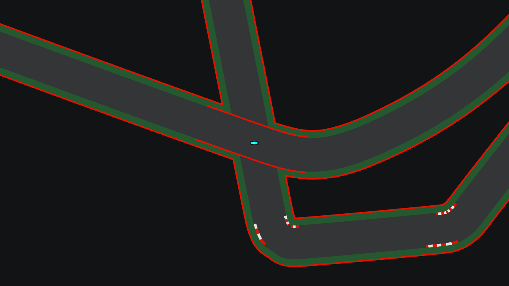
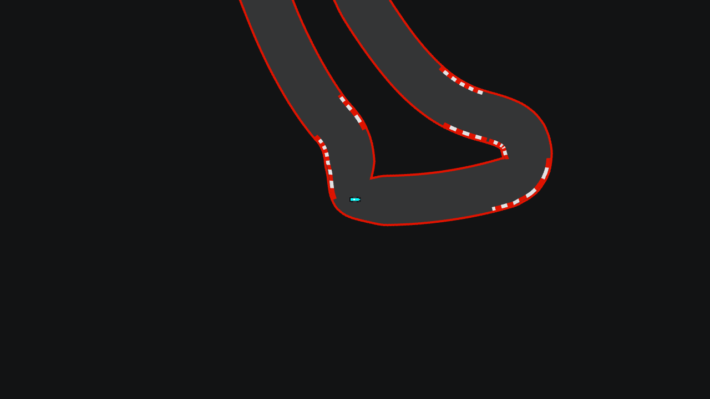

# Etapa 17: Pianos y cruce de Suzuka

## Objetivo

Terminar dos pendientes del dibujo de los circuitos desde la [etapa 10](10-circuitos-vectoriales-y-hud.md): los pianos en las curvas y el cruce de Suzuka, donde la pista pasa por encima de sí misma.

## Qué se hizo

| Pieza | Qué cambió |
|---|---|
| `vista/Pianos` (nueva) | Calcula los pianos a partir de la línea central |
| `juego/ZonaCruce` y `juego/NivelCruce` (nuevas) | La zona alrededor del cruce, las muestras que forman el puente y en qué nivel va cada auto |
| `VistaCircuito` | Dibuja los pianos y, aparte, los puentes (`dibujarPuentes`) |
| `PantallaCarrera` | Dibuja la pista, los autos de abajo, el puente y el resto de los autos, en ese orden |
| `Carrera` | No choca a dos autos que van en niveles distintos del cruce |
| `PilotoBot` | No esquiva ni frena por un auto que va en el otro nivel |
| `PruebaCruce` (nueva) y `CapturaVista` | Comprueban los niveles y los choques, y capturan un auto debajo del puente |

## Decisiones

**Los pianos son solo dibujo.** La grilla de colisión no los conoce, así que no cambian cómo se maneja. Se calculan al cargar el circuito, en la vista: no hubo que regenerar ningún JSON ni tocar la forma de las pistas.

**Qué curvas llevan piano.** Las de radio menor a 500 px. El piano va en el interior de la curva y en el exterior de su salida. Es un punto de partida, porque esta decisión es de gusto: se ajusta en las constantes de `Pianos`.

**El muro del puente es solo dibujo.** Joaquín eligió esta opción entre dos. La otra era una grilla de colisión por nivel, que toca `Circuito`, `Auto` y la física del servidor, justo lo que todavía no se probó en una red real. La consecuencia es que un auto puede salirse por el costado del puente hacia la pista de abajo. No gana nada: se saltea checkpoints y la vuelta no le cuenta.

**El nivel se decide por la posición al entrar a la zona.** El plan era usar el ángulo del auto, pero la posición resultó más simple y más firme: al entrar, los dos tramos están bien separados, y el auto que va a contramano o de costado se clasifica igual. El nivel se mantiene hasta salir, porque en el centro los tramos se pisan y la posición ya no dice por dónde venía el auto.

**No cambió el protocolo.** El servidor calcula el nivel para los choques y cada cliente lo calcula para el dibujo, con la posición que ya recibe en `ESTADO`. Si por una ráfaga de paquetes perdidos un cliente ve aparecer un auto directamente en el centro del cruce, podría dibujarlo en el nivel equivocado durante ese paso. Solo afecta al dibujo: lo que pasa en la carrera lo sigue decidiendo el servidor.

## Problemas y cómo se resolvieron

| Problema | Causa | Solución |
|---|---|---|
| El puente terminaba en un óvalo de pasto y muro que tapaba la pista | Estaba armado con los mismos círculos que el resto del circuito, y el último círculo de cada capa asomaba | El puente es una cinta sin pasto y con los extremos rectos |
| En las curvas más cerradas, los pianos se plegaban sobre sí mismos y se metían en la pista | En una esquina más cerrada que el ancho de la pista, el punto corrido desde la línea central cae adentro de la curva | Cada pedazo de piano se dibuja solo si está sobre el borde real del asfalto, y se descartan los pedazos muy cortos. Por eso las esquinas más vivas, como las de la chicana de Monza, quedan sin piano del lado de adentro |
| La primera versión de `PruebaCruce` daba una falla | Un error de la prueba: dejaba un auto fuera de la zona y lo teletransportaba al centro, donde los tramos se pisan | Los autos de la prueba ahora entran a la zona por su tramo, como en una carrera |

## Verificación

- `PruebaCruce`: un auto que recorre cada tramo queda siempre en su nivel (424 px de zona). Dos autos en niveles distintos, puestos a 4 px, no se chocan. Dos en el mismo nivel se separan hasta 20 px, tanto abajo como arriba. Los otros 23 circuitos no tienen zona de cruce.
- `PruebaVuelta`: los tiempos de los 24 circuitos dan exactamente igual que antes de esta etapa (60,9 s de promedio).
- `PruebaBots`, con el código de antes y el de ahora: salida idéntica en los 24 circuitos. En esa prueba, los bots no llegan a molestarse en el cruce.
- `PruebaCircuitos`, `PruebaSalaBots` (reglas de la sala contra el servidor real) y `CapturaPantallas` terminaron sin errores.
- Se revisaron capturas de Suzuka (con un auto arriba y otro debajo del puente), Mónaco y Monza.

**Sin verificar:**
- **Jugando:** nadie lo probó todavía en una carrera manejando. Un auto a velocidad máxima queda tapado unos 0,36 s bajo el puente (162 px a 450 px/s) y falta ver cómo se siente.
- **Pianos en el resto de los circuitos:** solo se miraron de cerca los de Suzuka, Mónaco y Monza.
- **Red real:** no se probó entre varias PC.

## Uso de IA

El código y esta documentación los escribió Claude (Claude Code) a pedido de Joaquín, que pidió los pianos y el cruce, eligió que el muro del puente sea solo dibujo y aprobó el plan.

## Commits y PR

Rama `feature/pianos-y-cruce`: `426f3f1` (código, pruebas y documentación). Entró a `develop` con el PR [#20](https://github.com/joakinkong/35-Racing/pull/20) y a `main` con el [#21](https://github.com/joakinkong/35-Racing/pull/21).
