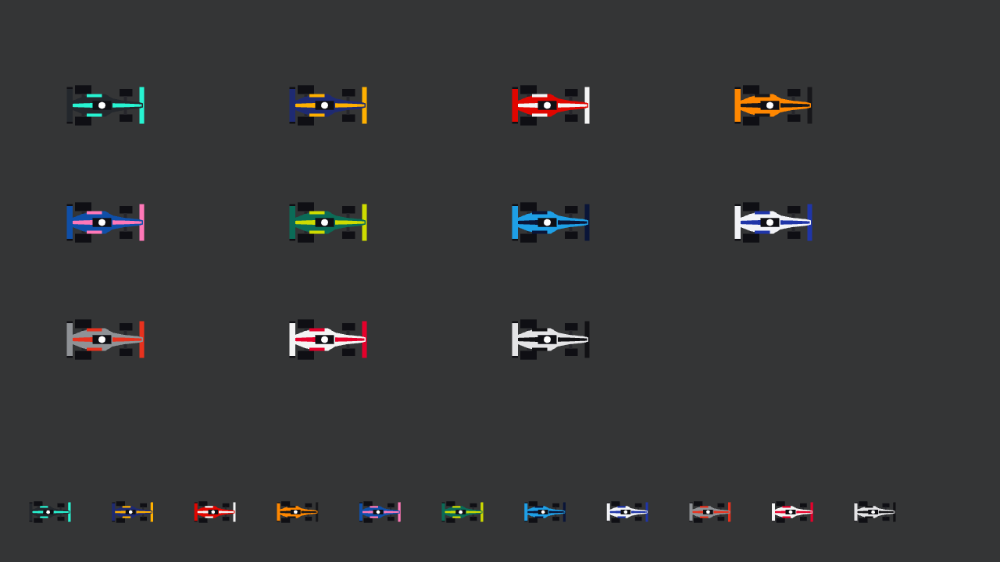

# Etapa 18: Entorno de los circuitos y autos nuevos

## Objetivo

Que los circuitos dejen de flotar sobre un fondo negro y que los autos dejen de ser rectángulos. Joaquín pidió que los circuitos callejeros tengan calles, edificios y autos alrededor, y que los permanentes tengan pasto, tribunas, ambulancias y muros, con un pack de assets que compró.

## Qué se hizo

| Pieza | Qué cambió |
|---|---|
| `tools/entorno/armar_atlas.py` (nuevo) | Toma 70 sprites del pack, los reduce a la mitad y los junta en `assets/entorno/entorno.png` con su `.atlas`, más 3 baldosas para el suelo |
| `vista/DisposicionEntorno` (nueva) | Decide qué decoración va y dónde, a partir de la línea central. No usa clases gráficas |
| `vista/VistaEntorno` (nueva) | Dibuja el suelo, las calles, las piezas y el público de las tribunas, solo lo que entra en la cámara |
| `VistaCircuito` | Dibuja el entorno antes de la pista, en lugar del fondo liso |
| `VistaAuto` | Monoplaza visto desde arriba, hecho con polígonos, con la carrocería y el acento de cada escudería |
| `Escuderia`, `Catalogo` y `Paleta` | Colores nuevos para los autos, tomados de fotos de los autos de 2026 que pasó Joaquín, separados del color de la interfaz |
| `Circuito` y `CargadorCircuito` | La geometría ahora incluye el campo `callejero`, que ya estaba en los JSON |
| `Pianos` | Expone las curvas, para ubicar tribunas y protecciones del lado de afuera |
| `PruebaEntorno` (nueva) | Comprueba la ubicación de las piezas en los 24 circuitos |

**Permanentes (15):** pasto, tribunas con público en todos los bordes de la pista, ambulancias, neumáticos, vallas y muros decorativos en las rectas, árboles y arbustos.

**Callejeros (9):** vereda, una grilla de calles con línea punteada, edificios, autos estacionados, faroles, barreras, carteles, ambulancias y tribunas donde entren.

## Decisiones

**El entorno es solo dibujo.** Nada de esto entra en la grilla de colisión ni viaja por la red. El servidor no lo calcula y el protocolo no cambia. El muro rojo sigue siendo el que choca, y las vallas y muros del pack son decoración detrás de él, porque el pack solo los trae rectos y las pistas tienen curvas de cualquier ángulo.

**No se tocaron los JSON ni la forma de las pistas.** La disposición se calcula al cargar el circuito y solo depende de la línea central: el mismo circuito queda siempre igual, en todas las PC.

**Los F1 no salen del pack.** El pack trae autos de calle, pero no monoplazas. Las láminas de equipos que había en la carpeta del proyecto tampoco se usaron: cubrían 5 de las 11 escuderías, tenían pilotos de otros años, un fondo sin transparencia y logos de marcas reales. Con polígonos salen los 11 equipos con sus colores.

**Las tribunas son las del pack, con público agregado.** El pack solo trae gradas de madera y sin gente. El público son cuadraditos de colores dibujados encima, siempre iguales para cada tribuna. Siempre miran a la pista: el pack las trae mirando abajo, a la izquierda y a la derecha, y las que miran arriba se arman dando vuelta las primeras.

**El color del auto es aparte del de la interfaz.** Mercedes y Red Bull corren casi negros, y en la torre de tiempos o en el mapa esos colores no se leerían sobre el fondo oscuro. Por eso la interfaz conserva los colores que tenía, y el auto usa los suyos. Los equipos con la misma carrocería se distinguen por el acento: Haas lleva rojo y Cadillac negro, sobre blanco, y Racing Bulls, azul.

**La mezcla de estilos es a propósito.** La pista sigue siendo vectorial y el entorno es pixel art reducido, visto un poco desde arriba y no desde arriba del todo. Funciona porque la cámara no rota.

## Problemas y cómo se resolvieron

| Problema | Causa | Solución |
|---|---|---|
| Casi no aparecían neumáticos, y las vallas quedaban sueltas | La grilla de ocupación tenía celdas de 16 px, y cada pieza le quitaba el lugar a la siguiente | Celdas de 8 px, y las hileras se marcan recién al terminar de ubicarlas |
| Las tribunas parecían pilas de troncos | El sprite es de bancos vacíos, y quedaban muy separadas | Público encima, y se prueba cada 2 muestras para que queden seguidas |
| La vereda distraía de la pista | Las juntas del pack son muy marcadas y es muy clara a esta escala | El script la mezcla con un gris liso |
| Las capturas seguían sin mostrar las tribunas nuevas, aunque la prueba las contaba | El programa de capturas leía la copia vieja de `assets` en `lwjgl3/build/resources`, con los nombres de sprites anteriores | Correr `gradlew lwjgl3:classes` antes de capturar, y anotarlo en el `LEEME` |
| Las tribunas de Mónaco quedaban sobre las calles | Lo que se ubica al costado de la pista no miraba las calles | Ahora evita las calles, salvo los autos estacionados |

## Verificación

- `PruebaEntorno`, en los 24 circuitos: ninguna pieza toca la pista ni su muro, ninguna se sale del mapa, ninguna pisa a otra (salvo las hileras de vallas y muros, que se tocan a propósito) y dos cálculos dan lo mismo. Son de 888 piezas (Miami) a 4.863 (Monza), y el cálculo tarda como mucho unos 20 ms.
- `PruebaVuelta` y `PruebaBots`: salida idéntica a la de la etapa anterior en los 24 circuitos.
- `PruebaCircuitos` y `PruebaCruce` pasan, y `CapturaPantallas` recorre el juego real, con una carrera contra bots, sin errores.
- `gradlew lwjgl3:jar` incluye los archivos de `assets/entorno`.
- Se revisaron capturas de Monza, Mónaco, la carrera real y las 11 escuderías (`CapturaAutos`). Los demás circuitos se comprobaron con `PruebaEntorno`, pero no se miraron uno por uno.

**Sin verificar:**
- **Jugando:** nadie lo manejó todavía.
- **Rendimiento:** no se midieron los cuadros por segundo con la ventana visible, y Monza suma miles de piezas, aunque se dibujan solo las que entran en la cámara.
- **Red real:** no se probó entre varias PC.

## Commits y PR

Rama `feature/entorno-y-autos`: `b8bc515` y `78d68d8`. Entró a `main` con el PR [#23](https://github.com/joakinkong/35-Racing/pull/23).
