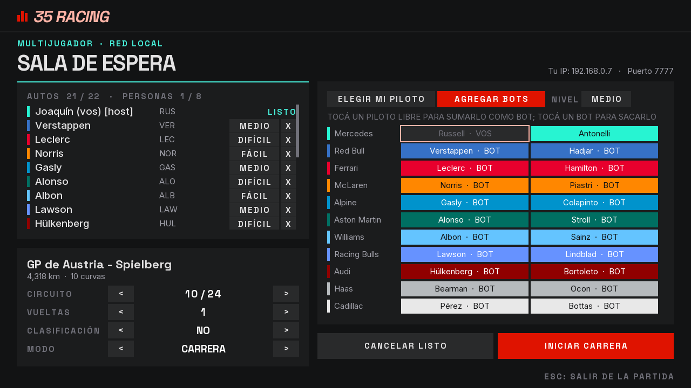
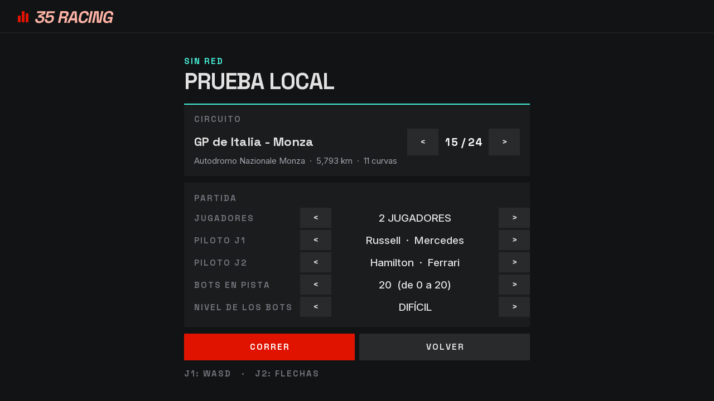
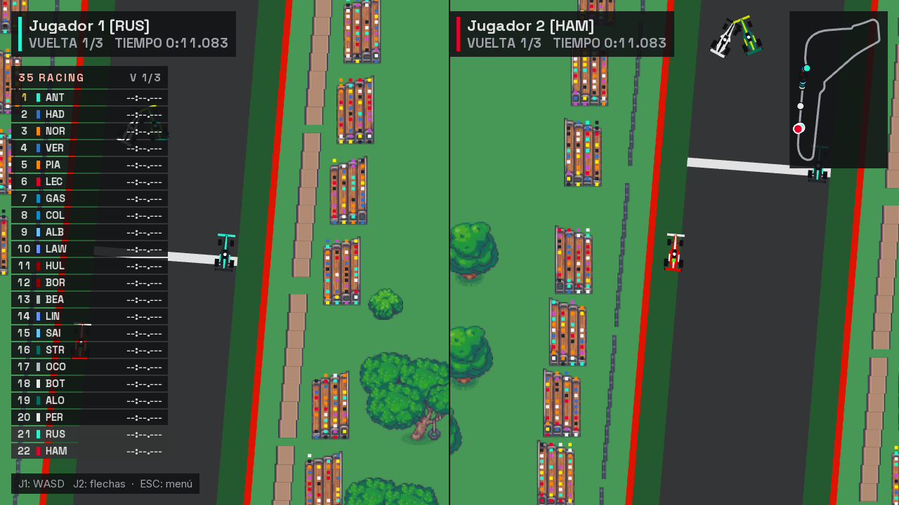

# Etapa 19: Veintidós autos, capacidad de la sala y bots a elección

## Objetivo

Que la partida pueda tener los 22 pilotos de la grilla en pista, que quien crea la sala decida cuántos autos entran, que el host elija qué piloto suma como bot (y no que se agreguen en el orden del catálogo), que dos pilotos de la misma escudería corran a la vez, y que la prueba local permita 1 o 2 jugadores y los bots que se quieran.

Reglas de esta etapa, que pidió Joaquín: como máximo **8 personas** reales, y como máximo **22 autos** entre personas y bots. El segundo piloto de cada escudería lleva un cuadradito verde fluo en el techo, como en la F1.

## Qué se hizo

| Pieza | Qué cambió |
|---|---|
| `Config` | `MAX_JUGADORES` pasa de 8 a 22, y aparece `MAX_PERSONAS` (8). Tabla de puntos de la F1 para más de 8 autos. Protocolo versión 8 |
| `ServidorPartida` | La sala tiene una `capacidad` (de 2 a 22) que se fija al crearla. Las personas no pasan de 8. Ya no hay una escudería por jugador: un piloto lo tiene un solo auto. `AGREGAR_BOT` lleva el piloto. Elegir el piloto de un bot los intercambia |
| `EstadoLobby`, `Protocolo`, `ClientePartida` | El `LOBBY` informa la capacidad; `AGREGAR_BOT;nivel;piloto`; el error `PILOTO_OCUPADO` reemplaza a `ESCUDERIA_OCUPADA` |
| `UnirsePartida` | Al crear la partida se elige cuántos autos entran (de 2 a 22; por defecto 8) |
| `Lobby` | La lista de autos se desplaza (22 filas no entran) y muestra el cupo; la grilla de 22 pilotos tiene dos modos para el host: "elegir mi piloto" y "agregar bots", con el nivel a elección. Cada botón dice quién tiene al piloto |
| `PruebaLocal`, `PartidaLocal`, `SimulacionLocal` | 1 o 2 jugadores, piloto de cada uno, bots en pista (de 0 a 22 menos los jugadores) y su nivel. La simulación local corre los bots con `PilotoBot`, igual que el servidor |
| `VistaAuto`, `Catalogo` | El segundo piloto de cada escudería lleva un cuadrado verde fluo en el techo |
| `TorreHud`, `Resultados`, `PantallaGrilla` | Filas compactas en la torre con más de 12 autos; las tablas de resultados y de grilla se desplazan si no entran |
| `generar_circuitos.py` y los 24 JSON | 22 lugares de largada por circuito |
| `Torneo` | Con más de 8 autos, tabla de la F1 (25, 18, 15, 12, 10, 8, 6, 4, 2, 1 y 0 para el resto) |

## Decisiones

**Capacidad en autos y tope de personas aparte.** La sala se crea con una capacidad de 2 a 22 autos y las personas no pasan de 8 (o de la capacidad, si es menor). Si la sala está llena y entra una persona, sale el último bot, como antes.

**Un piloto por auto, no una escudería por jugador.** Antes se bloqueaba la escudería entera, porque el color era lo único que distinguía a los autos. Ahora los dos pilotos de una escudería pueden correr juntos y el segundo se reconoce por el cuadrado verde. Si una persona elige el piloto de un bot, se intercambian y ninguno se queda sin piloto; si lo tiene otra persona, se rechaza.

**Puntos del torneo.** La tabla "desde el último" tiene 8 valores y con 22 autos el ganador sumaría 22 o más. Para hasta 8 autos queda como estaba. Con más se usa la tabla de la F1, donde puntúan los 10 primeros. Nota: en la propuesta inicial se dijo "más de 10 autos"; se cambió a "más de 8" porque con 9 o 10 autos la tabla invertida se queda sin valores.

**Grilla de largada.** Los primeros 8 lugares quedan como estaban (40 px entre autos). Del noveno en adelante la grilla se aprieta a 28 px, para que los 22 autos entren detrás de la meta: el último queda a unos 730 px. El generador no avisó ningún lugar fuera de la pista en los 24 circuitos. Los diffs de los JSON son solo los 14 lugares nuevos.

**ESTADO con 22 autos.** Sigue siendo un solo datagrama: 540 bytes, por debajo del límite de 1.472. Con 8 personas y 22 autos el host manda unos 119.280 bytes/s a los 7 remotos y recibe 16.380 (unos 1,09 Mbit/s en total); los bots no reciben nada. La cuenta está en `docs/PROTOCOLO.md`.

## Problemas y cómo se resolvieron

| Problema | Causa | Solución |
|---|---|---|
| Las pruebas de `tools/bots` suponían 8 autos y una escudería por jugador | Las reglas cambiaron | `PruebaSalaBots` y `PruebaTorneo` se actualizaron; `PruebaCapacidad` y `PruebaLocal22` son nuevas |
| La captura de pantallas sumaba 21 invitados como personas | Contaba hasta `MAX_JUGADORES` | Ahora cuenta hasta `MAX_PERSONAS` |
| El estado "ESPERANDO" quedaba tapado por la barra de desplazamiento | La barra ocupa los últimos píxeles de la lista | Se le dejó aire a la derecha de cada fila |

## Verificación

- `PruebaCapacidad` (servidor real, clientes reales por TCP): la sala de 4 autos informa su capacidad y rechaza el quinto; en la sala de 22 se suma un bot con el piloto pedido, se rechaza un piloto repetido con `PILOTO_OCUPADO`, los dos pilotos de una escudería corren a la vez, elegir el piloto de un bot los intercambia, entran 8 personas y la novena se rechaza, se completan 22 autos con 22 pilotos distintos y la `CUENTA_REGRESIVA` trae los 22 en la grilla.
- `PruebaLocal22`, en los 24 circuitos: 2 personas y 20 bots largan y los 20 bots avanzan.
- `PruebaTorneo` (la parte de puntos): con 12 autos 25, 18, 15, 12, 10, 8, 6, 4, 2, 1, 0, 0; con 22, gana 25 y el último no suma; los repartos de 2, 4 y 8 autos siguen igual.
- `PruebaSalaBots`, corrida completa en tiempo real con una carrera y revancha, pasa con las reglas nuevas.
- `CapturaPantallas veintidos` recorre el juego real: sala llena en modo de agregar bots, prueba local con 2 jugadores y 20 bots, y la carrera con los 22 autos y la torre de tiempos completa. Se revisaron las capturas (`img/19-*.png`).

**Sin verificar:**
- **Jugando:** nadie manejó una carrera completa con 22 autos; no se midió cómo se siente el tráfico en la largada con la grilla apretada, ni si los bots se atascan en las primeras curvas.
- **Red real:** `PruebaCapacidad` corre en una sola PC; no se probó con 8 personas en distintas PC, ni el ancho de banda de 22 autos en una Wi-Fi.
- **Torneos y clasificación con 22 autos:** solo se comprobaron los puntos; no se corrió un torneo completo ni una clasificación con tantos autos.
- **El cuadradito verde:** se ve en la captura de la carrera, pero no se miró de cerca en todas las escuderías.
- **Etapas anteriores:** `PruebaClasificacion` y la parte de servidor de `PruebaTorneo` no se volvieron a correr.

## Commits y pull request

Sin commits todavía al escribir esta etapa.
